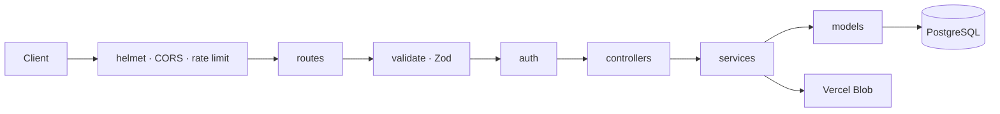

<div align="center">

# 👕 Clothes Store API

### Fashion e-commerce REST API with sizes, colors and Vercel Blob storage

      

**[📦 Source](https://github.com/n1j10/backend-clothes-store)**

</div>

---

## ✨ Overview

A REST API for a clothing store: products with **size and color variants**, a separate cart line per variant, orders with tax and shipping, reviews and favorites. Images go to **Vercel Blob** in production and to local disk in development.

The code follows a **layered architecture** (routes → middlewares → controllers → services → models → Prisma), which keeps business logic testable and keeps controllers out of the database. It runs as a normal server locally and as a **Vercel serverless function** in production (`api/index.js`).



## 🔐 Security

Security was designed in from the start:

| Area | Implementation |
| --- | --- |
| Authentication | JWT (HS256 pinned) with bcrypt-hashed passwords. The user is reloaded from the database on every request; admin routes use role-based `requireAdmin` |
| Rate limiting | Global limit of 300 requests per minute per IP, plus a strict limit on login and register (10 per 15 minutes) against brute force |
| Uploads | Explicit image MIME allow-list (JPEG, PNG, WebP, GIF, AVIF; **SVG is rejected**), 1 MB limit, server-generated file names and extensions |
| Validation | Zod validates body, query and params; cart quantities must be 1–100 |
| Hardening | `helmet` headers, body size limits, `trust proxy` for correct client IPs, `X-Powered-By` disabled |
| Error handling | One central error handler; internal errors are never shown to clients in production |
| Ownership | Users can only delete their own reviews, and each user gets one review per product |

> Secrets are stored only in environment variables. `.env*` is git-ignored, and `.env.example` contains placeholders only.

---

## Layers

```
routes  ->  middlewares (auth / validate / upload)  ->  controllers  ->  services  ->  models  ->  Prisma
```

- **routes** – URLs only.
- **controllers** – read `req`, call a service, send the response. No business logic.
- **services** – the logic ported from the actions (cart totals, order from cart, favorite toggle).
- **models** – every Prisma query lives here, so no controller touches the database directly.

## Setup

```bash
npm install
cp .env.example .env     # then set DATABASE_URL and JWT_SECRET
npx prisma migrate dev --name init
npm run dev
```

## Endpoints

| Method | Path | Auth | Ported from |
| --- | --- | --- | --- |
| POST | `/api/users/register` | – | (new, replaces Clerk) |
| POST | `/api/users/login` | – | (new, replaces Clerk) |
| GET | `/api/users/me` | user | `getAuthUser` |
| GET | `/api/products` | – | `fetchAllProducts` (`?search=&category=`) |
| GET | `/api/products/featured` | – | `fetchFeaturedProducts` |
| GET | `/api/products/mine` | admin | `fetchAdminPosts` |
| GET | `/api/products/:id` | – | `fetchSingleProduct` |
| POST | `/api/products` | admin | `createProductAction` (multipart, field `image`) |
| PATCH | `/api/products/:id` | admin | `updateProductAction` |
| PATCH | `/api/products/:id/image` | admin | `updateProductImageAction` |
| DELETE | `/api/products/:id` | admin | `deleteProductAction` |
| GET | `/api/cart` | user | `fetchOrCreateCart` + `updateCart` |
| GET | `/api/cart/count` | optional | `fetchCartItems` |
| POST | `/api/cart/items` | user | `addToCartAction` |
| PATCH | `/api/cart/items/:itemId` | user | `updateCartItemAction` |
| DELETE | `/api/cart/items/:itemId` | user | `removeCartItemAction` |
| POST | `/api/orders` | user | `createOrderAction` |
| POST | `/api/orders/:id/pay` | user | `payOrderAction` |
| GET | `/api/orders` | user | `fetchUserOrders` |
| GET | `/api/orders/all` | admin | `fetchAdminOrders` |
| POST | `/api/reviews` | user | `creatReviewAction` |
| GET | `/api/reviews/product/:productId` | – | `fetchProductReview` |
| GET | `/api/reviews/mine` | user | (new) |
| GET | `/api/reviews/all` | admin | `fetchAllReviews` |
| DELETE | `/api/reviews/:id` | user (own) | (new) |
| GET | `/api/favorites` | user | `fetchUserFav` |
| GET | `/api/favorites/status/:productId` | optional | `fetchFavoritID` |
| POST | `/api/favorites/toggle/:productId` | user | `toggleFavAction` |

Every response has the same shape:

```json
{ "success": true, "message": "Success", "data": {} }
```

## What changed from the Next.js version

| Next.js | Express |
| --- | --- |
| Clerk (`clerkId`, `getAuthUser`, `getAdminUser`) | local `User` model + JWT, `authenticate` / `requireAdmin` |
| Supabase storage | `multer` to disk, served from `/uploads` |
| ZainCash checkout redirect | `POST /api/orders/:id/pay` marks the order paid |
| `revalidatePath` / `redirect` | nothing – the API just returns JSON |
| `renderError` returning `{ message }` | thrown `ApiError` handled by `error.middleware.js` |
| `validateFuctionSchema` | `validate.middleware.js` (same Zod schemas) |

Author name and image are no longer sent with a review — they are read from the
logged-in user. A user can review a product once.

## Tests

```bash
npm test
```

## 👤 Author

**n1j10**, full-stack engineer (Next.js · TypeScript · Node.js · PostgreSQL)

[](https://github.com/n1j10)

> If you find this project useful, a ⭐ on the repo is appreciated.
